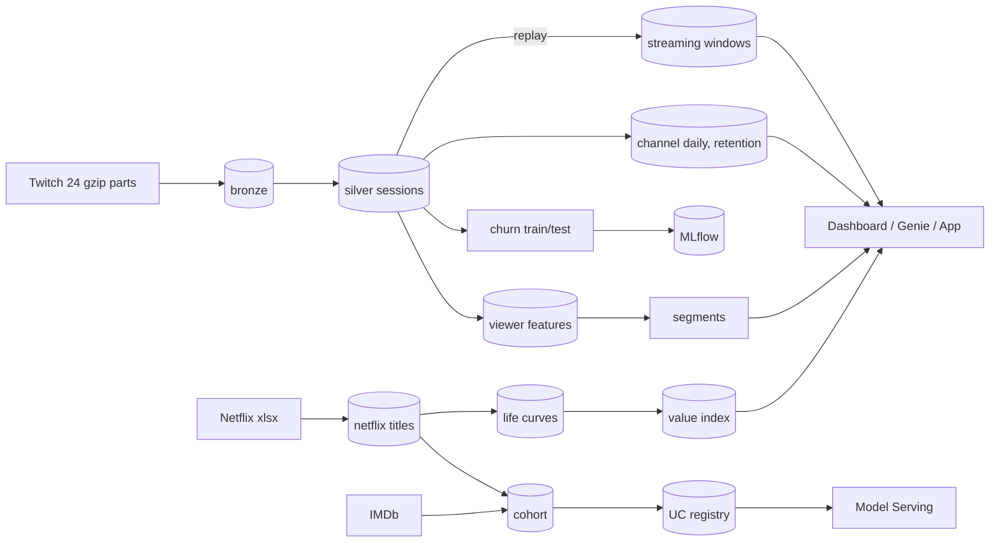

# Streaming content analytics on Databricks

A Delta Lake / Unity Catalog lakehouse on **474.7M Twitch viewing intervals** (15.5M viewers) plus **Netflix engagement reports** joined to IMDb (2,535 titles). It covers viewer segmentation, a next-week return model, audience life curves, a pre-release performance score, a value index, and an A/B design note. Everything is deployed with an Asset Bundle and a GitHub Actions workflow.

> **Where it ran.** All stages ran on **Databricks Free Edition serverless** on the full table; the numbers below come from those runs (`reports/results/databricks/`). The same code also ran on one Mac (`local[*]`) for the tuning experiments Free Edition does not allow and for the benchmark.
> **Twitch is a proxy** (live-chat presence, not subscriber data). The streaming job is a **replay**, and the A/B results are **simulated**. The Lakeflow pipeline ran on the 100k-viewer sample only. I did not look at the dashboard or the app rendered.

## Key numbers

Generated from the result files by `reports/make_results.py` (`--check` fails if this table is stale); details in [reports/results.md](reports/results.md).

<!-- KEY-NUMBERS:BEGIN (generated by reports/make_results.py) -->
| Quantity | Value |
|---|---|
| Twitch interactions processed (bronze rows) | 474,676,930 |
| Silver rows after validation/dedup (rows dropped: 0) | 474,676,930 |
| Viewer sessions (gap rule 3 slots = 30 min) | 349,257,238 |
| Viewers segmented | 15,524,309 |
| Channels | 790,100 |
| Sessionization wall time, full 474M rows (Databricks serverless) | 95 s |
| Chosen k (bootstrap ARI 0.964, silhouette 0.244) | 7 |
| Viewers staying in the same segment first half -> second half | 42.5% |
| eta^2 (H2 log hours): segments / hours in equal-size groups | 0.387 / 0.473 |
| ALS embeddings: bootstrap ARI behaviour-only vs +embedding | 0.824 vs 0.472 |
| Twitch new-channel decay hold-out RMSE (log), large: exp / power / persistence | 1.02 / 1.00 / 1.01 |
| Twitch new-channel decay hold-out RMSE (log), medium: exp / power / persistence | 0.99 / 0.99 / 0.99 |
| Twitch new-channel decay hold-out RMSE (log), small: exp / power / persistence | 0.81 / 0.80 / 0.80 |
| Netflix score, 2026H1 fold: Spearman LightGBM / genre-median / prior-season | 0.69 / 0.53 / 0.60 |
| Netflix score, 2026H1: top-decile precision LightGBM / genre-median | 0.54 / 0.37 |
| Conformal 80% interval empirical coverage, 2026H1 (n=349) | 83.1% |
| IMDb match rate (cohort) | 84.5% |
| Value-index hold-out Spearman (1 semester observed): power / exponential / median-ratio / persistence | 0.87 / 0.82 / 0.85 / 0.85 |
| Value-index hold-out median APE (1 semester observed): power / exponential / median-ratio / persistence | 0.49 / 1.66 / 0.42 / 15.15 |
| Re-engagement model, test (n=2,910,491): ROC-AUC GBT / logistic regression | 0.799 / 0.785 |
| Re-engagement model: churn lift in riskiest decile, GBT | 2.51x |
| A/B simulation: CUPED variance ratio (rho 0.71) / A/A false positives naive peeking, 10 looks | 0.49 / 17.0% |
| Benchmark, 100% of data (474.7M rows): sessionize + features + KMeans, warm median: Databricks serverless / Mac (24 GB heap) | 454 s / 515 s |
| Benchmark, 1% of data, warm median: Databricks / Mac | 23 s / 13 s |
<!-- KEY-NUMBERS:END -->

## Findings, including the negative ones

| Question | Result |
|---|---|
| **Viewer segments** (MLlib KMeans) | k=7 on Databricks, k=9 locally: the bootstrap-stability rule is noisy, so the k choice is **not reproducible**. Heavy viewers (20.6%) produce 59.7% of watch time. Only 42.5% of viewers keep their segment between the two halves of the window. Segments predict later volume *worse* than plain volume groups (eta² 0.387 vs 0.473). ALS embeddings *lowered* stability (ARI 0.824 → 0.472). |
| **Return next week** (LogReg, GBT) | 11.36M train / 2.91M test viewers, temporal split, disjoint viewers. GBT ROC-AUC **0.799** vs 0.785 for logistic regression; well calibrated; riskiest decile churns at 2.5x the base rate. Serverless took 17 min vs ~6 min on the Mac. |
| **Twitch life curves** | New channels do **not** decay over 28 days; persistence ties the decay fits. 27.7% of viewer-channel pairs from week 0 return in week 1. |
| **Netflix life curves** | Views per exposure day drop ~16x two semesters after the release semester; a power law fits far better than an exponential. Late points are survivors. |
| **Performance score** (LightGBM, pre-release features only) | 2026H1 hold-out, 349 titles: Spearman 0.69 vs 0.53 genre baseline and 0.60 prior-season; top-decile precision 0.54 vs 0.37. **Not uniformly better**: it loses to the baselines on 2025H1. 80% conformal intervals cover 74.5-86.0% and are wide (15-25x). |
| **Value index** | Power-law forecast: Spearman 0.87 with one semester observed (0.92 with two); a median-ratio method has lower median error (0.42 vs 0.49). |
| **A/B design** (simulated) | CUPED halves the variance (ratio 0.49; 92,792 → 45,408 viewers per arm for a 2% effect). Naive peeking: 17% false positives under no effect; mSPRT: 0.7%. See [docs/ab_testing.md](docs/ab_testing.md). |


## Databricks features used

Details and workarounds: [docs/platform.md](docs/platform.md); numbers: results sections 9-12.

* **Delta / Unity Catalog**: medallion tables, MERGE, change data feed, time travel and RESTORE (on a deep clone), CHECK constraints, comments and tags, feature tables, lineage, training snapshot reproduced by Delta version. OPTIMIZE and liquid clustering gave no significant gain on a 47M-row lookup.
* **Lakeflow pipeline**: Auto Loader → streaming table → materialized views with warn/drop/fail expectations (0 failed records on the sample).
* **MLlib** on serverless needed workarounds (environment v5, a volume path for `SPARKML_TEMP_DFS_PATH`; BisectingKMeans unsupported). **Structured Streaming** replay: 4.16M events, 10-21k rows/s on serverless vs 120-145k rows/s on the Mac.
* **MLflow / registry / serving**: LightGBM pyfunc in the UC registry with champion/challenger aliases, served from a scale-to-zero endpoint (p50 148 ms, p95 217 ms from Europe).
* **AI/BI dashboard, Genie space** (5 questions, ~17 s each), **Databricks App** (running, needs workspace sign-in).
* **Benchmark** ([reports/local_vs_databricks.md](reports/local_vs_databricks.md)): the Mac is faster at 1% of the data; serverless is faster from 50% (100%: 454 s vs 515 s); MLlib KMeans is slower on serverless; with a 4 GB heap the Mac fails with out-of-memory. This compares one Free Edition workspace with one workstation, not paid clusters.

## Continuous deployment

`.github/workflows/ci.yml`: pull requests run tests and `databricks bundle validate -t prod`; pushes to `main` run the tests, then validate and **deploy the `prod` bundle target**; a manual run also executes `sca_smoke` (100k sample, asserts 3,051,733 rows and 100,000 viewers).
Authentication is a personal access token stored as a GitHub secret.
Proof: push run [40537604496](https://github.com/waelsabri11/streaming-content-analytics/actions/runs/40537604496) deployed five jobs and the pipeline (`databricks bundle summary -t prod`); manual run [40538501680](https://github.com/waelsabri11/streaming-content-analytics/actions/runs/40538501680) deployed and ran `sca-smoke-prod`, which ended `TERMINATED SUCCESS`.

## Architecture



One codebase in `src/streaming_content`; local runs are tests and experiments. [`pipelines/twitch_pipeline.py`](pipelines/twitch_pipeline.py) is the Lakeflow version of bronze → silver.

## Rigor and limits

* **Leakage tests**: Netflix features must not move when everything from the release semester on is corrupted; churn features ignore everything at or after the cutoff, and intervals straddling it are clipped ([tests](tests)).
* **Spark tuning** (local, 10% sample): 192 partitions beat 8 (8.3 s vs 13.1 s); a broadcast join helped modestly (2.2 → 1.7 s); a salted distinct count was *slower* (4.4 → 7.0 s). Serverless does not let you set these confs.
* Netflix target is views in the *release semester* (the first full semester is censored); 15.5% of titles have no IMDb match; fits ignore survivorship; no business impact is estimated.
* The Free Edition quota size is unpublished; no quota error occurred. There is no scheduled run.
* More: [methodology](docs/methodology.md), [data card](docs/data_card.md), [model card](docs/model_card.md), [deploy steps](docs/deploy_databricks.md).

## Run it

```bash
uv sync                                    # Python 3.12; local runs need JDK 17
python ingest/download.py all              # ~7.4 GB with checksums
databricks auth login --host <workspace-url>
databricks bundle deploy -t dev            # wheel, jobs, pipeline
databricks bundle run sca_twitch -t dev    # after uploading raw files (docs/deploy_databricks.md)
python reports/make_results.py             # results.md + key numbers
uv run pytest                              # synthetic fixtures only
```

Data: Twitch (Rappaz, McAuley, Aberer, RecSys 2021; no licence stated), Netflix "What We Watched" reports and IMDb non-commercial datasets (none redistributed; no raw or per-title data is committed).
