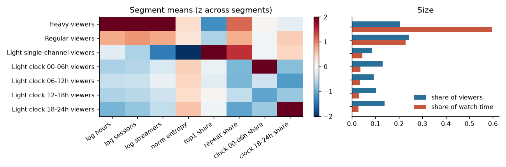
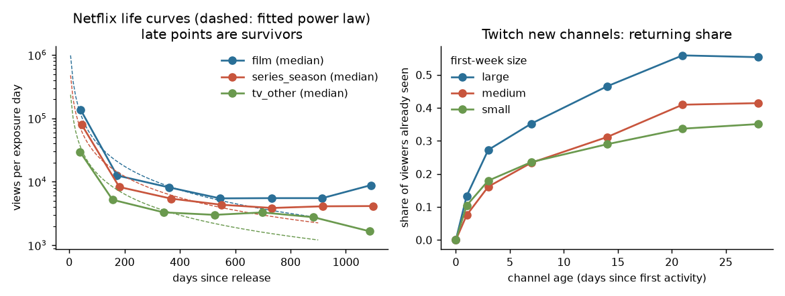
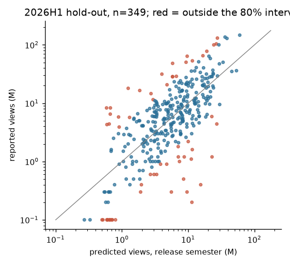
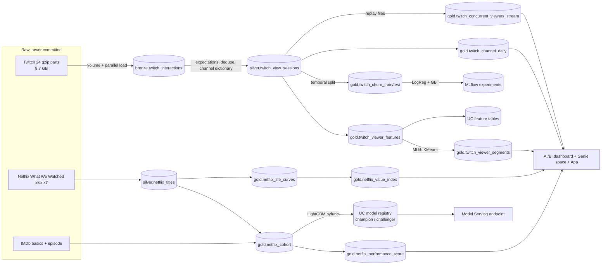

# Streaming content analytics: Databricks lakehouse on 474.7M Twitch viewing intervals + Netflix engagement reports

A Databricks lakehouse (Delta bronze/silver/gold in Unity Catalog, Lakeflow Declarative Pipeline with expectations, Spark MLlib, MLflow with a UC model registry and Model Serving, Structured Streaming, Asset Bundles,
AI/BI dashboard, Genie space, Databricks App) answering the questions a content-analytics team asks of a streaming catalogue:

1. **Who are the viewers?** Behavioural segmentation of 15.5M viewers (sessionization, MLlib KMeans, stability checks, ALS channel embeddings).
2. **Will a viewer come back next week?** Distributed supervised ML (MLlib logistic regression and GBT) on 14.3M viewer-weeks, with a strict temporal split and leakage tests.
3. **How does an audience live and die?** Twitch channel audience curves and Netflix title decay curves, normalised by exposure.
4. **How will a title perform, and what is it worth?** A pre-release performance score with conformal intervals, and a value index from the life curves (Netflix, 2,535 titles).
5. **How would we measure a promotion?** An A/B design note with CUPED, power/MDE from real variance and a **simulated** A/A, A/B and sequential test ([docs/ab_testing.md](docs/ab_testing.md)).

> **Where things ran.** Every pipeline stage ran on **Databricks Free Edition serverless** (workspace on AWS, environment version 5, deployed with an Asset Bundle) on the **full 474,676,930-row** Twitch table, and the results in this README come from those runs
> (`reports/results/databricks/`). The same code also ran locally on one Mac (PySpark 4.0.1 + Delta 4.0.0, `local[*]`, 12 threads, 48 GB) for the tuning experiments Free Edition does not allow and for the local-vs-Databricks comparison; where both exist they agree (e.g. churn ROC-AUC 0.7989 vs 0.7991).
> **Twitch is a proxy** for streaming consumption (chat presence on a live platform), not subscriber data. The Netflix side has 2,535 titles, not millions of rows. The streaming job is a **replay** of historical data, not a live feed.
> Not verified: a `prod` bundle target was not created; the Lakeflow pipeline was run on the 100k-viewer sample (3,051,733 rows) only, not on the full table; the dashboard and the app were created and are reported as running, but I did not look at them rendered.

## Key numbers

All values come from [`reports/results.md`](reports/results.md), generated from `reports/results/databricks/*.json` (Databricks) by code (`python reports/make_results.py --check` fails if this table is stale).

<!-- KEY-NUMBERS:BEGIN (generated by reports/make_results.py) -->
| Quantity | Value |
|---|---|
| Twitch interactions processed (bronze rows) | 474,676,930 |
| Silver rows after validation/dedup (rows dropped: 0) | 474,676,930 |
| Viewer sessions (gap rule 3 slots = 30 min) | 349,257,238 |
| Viewers segmented | 15,524,309 |
| Channels | 790,100 |
| Sessionization wall time, full 474M rows (local[*]) | 95 s |
| Chosen k (bootstrap ARI 0.964, silhouette 0.244) | 7 |
| Viewers staying in the same segment first half -> second half | 42.5% |
| eta^2 (H2 log hours): segments / hours in equal-size groups | 0.387 / 0.473 |
| ALS embeddings: bootstrap ARI behaviour-only vs +embedding | 0.824 vs 0.472 |
| Twitch new-channel decay hold-out RMSE (log), large: exp / power / persistence | 1.02 / 1.00 / 1.01 |
| Twitch new-channel decay hold-out RMSE (log), medium: exp / power / persistence | 0.99 / 0.99 / 0.99 |
| Twitch new-channel decay hold-out RMSE (log), small: exp / power / persistence | 0.81 / 0.80 / 0.80 |
| Netflix score, 2026H1 fold: Spearman LightGBM / genre-median / prior-season | 0.69 / 0.53 / 0.60 |
| Netflix score, 2026H1: top-decile precision LightGBM / genre-median | 0.54 / 0.37 |
| Conformal 80% interval empirical coverage, 2026H1 (n=349) | 83.1% |
| IMDb match rate (cohort) | 84.5% |
| Value-index hold-out Spearman (1 semester observed): power / exponential / median-ratio / persistence | 0.87 / 0.82 / 0.85 / 0.85 |
| Value-index hold-out median APE (1 semester observed): power / exponential / median-ratio / persistence | 0.49 / 1.66 / 0.42 / 15.15 |
| Re-engagement model, test (n=2,910,491): ROC-AUC GBT / logistic regression | 0.799 / 0.785 |
| Re-engagement model: churn lift in riskiest decile, GBT | 2.51x |
| A/B simulation: CUPED variance ratio (rho 0.71) / A/A false positives naive peeking, 10 looks | 0.49 / 17.0% |
| Benchmark, 100% of data (474.7M rows): sessionize + features + KMeans, warm: Databricks serverless / Mac (24 GB heap) | 428 s / 498 s |
| Benchmark, 1% of data, warm: Databricks / Mac | 23 s / 13 s |
<!-- KEY-NUMBERS:END -->

## What the results say (including what did not work)

**Volumes (Databricks).** 474,676,930 rows, 15,524,309 viewers, 790,100 channels, 349,257,238 sessions; zero rows failed validation, zero duplicates. The source page's "124M interactions / 465k streamers" is stale ([data card](docs/data_card.md)).
Load of 24 gzip parts 140 s, sessionization 95 s on serverless. (The original single 6.9 GB gzip cannot be uploaded in one request or read in parallel: I re-split it into 24 parts locally; see [platform notes](docs/platform.md).)

**Segmentation.** Rule fixed in advance (k in 4-10, bootstrap ARI >= 0.80, then best silhouette) gave **k = 7** on Databricks and **k = 9** in the local run: the bootstrap-ARI criterion is noisy (it jumps between 0.56 and 0.96 across neighbouring k), so the k choice is **not reproducible** between runs and 6-9 segments should be read as equivalent.
Silhouette is low everywhere (0.22-0.25): behaviour is a continuum. The heavy 20.6% of viewers produce 59.7% of watch time; the other segments split by time-of-day window (dataset clock) and loyalty. 
* Stability is **moderate**: model-vs-model ARI across time halves 0.55, and only 42.5% of viewers fall in the same segment from the first to the second half of the window.
* Segments **predict second-half volume worse than plain first-half volume cut in the same number of groups** (eta^2 0.387 vs 0.473).
* **ALS embeddings did not help**: adding 16 fold-in dimensions lowered bootstrap ARI (0.824 -> 0.472) and eta^2 (0.388 -> 0.332).
* Process note: my first local run used single-seed KMeans and picked k = 5 on a lucky bootstrap ARI (0.985) while the seed-only ARI was 0.61 (kept in `reports/results/earlier_run.json`); I added KMeans restarts (best of 3) and reran.

**Re-engagement model (distributed ML).** Features from 3 weeks before a cutoff, label = any viewing in the next 7 days, test window shifted by one week and a disjoint 20% of viewers: 11,358,809 train / 2,910,491 test viewers. 77.8% of test viewers return.
GBTClassifier ROC-AUC **0.799**, logistic regression 0.785 (the gain is small; PR-AUC 0.936 vs 0.930 is dominated by the 78% base rate). Calibration is good (deciles within 0.05 of observed); the riskiest decile has a churn rate 2.5x the base rate.
Strongest features: active days, last-week active days, recency. The churn task took 17 min on serverless (GBT 12 min) vs about 6 min locally: the Mac is faster on this job.

**Life curves, Twitch.** New channels do **not** decay in this window: median daily viewers are flat over 28 days in every size tier, and a persistence baseline matches exponential and power-law fits on held-out days (log-RMSE 0.80-1.02).
27.7% of viewer-channel pairs first seen in week 0 are active again in week 1 (21.5% for week-1 cohorts).

**Life curves, Netflix.** The median series season's views per exposure day are about 16x lower two semesters after its release semester; a power law fits far better than an exponential (within-title MSE on log rate 0.20-0.25 vs 0.80-0.89). Late-age points are survivors (titles below the 50k-view floor disappear). 

**Performance score.** On the latest hold-out (2026H1, 349 titles) LightGBM reaches Spearman 0.69 vs 0.53 for a genre-median baseline and 0.60 for prior season; top-decile precision 0.54 vs 0.37. It is **not uniformly better**: on the 2025H1 fold the baselines have a higher Spearman (0.575 and 0.635 vs 0.547),
and on titles with a prior season the prior-season baseline is as good or better in all three folds. 80% conformal intervals cover 74.5%, 86.0% and 83.1% and are wide (about 15x-25x between lower and upper views). 

**Value index.** Power-law life curve is the best parametric forecast of views over the remaining semesters up to semester 4 (Spearman 0.87 with one semester observed, 0.92 with two); a non-parametric median-ratio method has a lower median error with one semester (0.42 vs 0.49); naive persistence is poor (median APE 15.1).

**A/B design (simulated).** From the real variance (pre/post correlation 0.715) CUPED roughly halves the variance (ratio 0.49), cutting the sample for a 2% effect from 92,792 to 45,408 viewers per arm; simulated A/A false positive rates 6.0% / 5.75% (naive / CUPED); power at 20,000 viewers per arm 46.8% vs 79.5%.
Naive peeking at 10 looks gives 17.0% false positives under no effect; an mSPRT gives 0.7%.

## Databricks platform: what was used, what worked, what did not

Full detail in [docs/platform.md](docs/platform.md) and results sections 9-12. Summary:
* **Delta / Unity Catalog**: medallion tables, MERGE upsert, change data feed, time travel and RESTORE (demo on a deep clone), CHECK constraints, table/column comments and tags, liquid clustering and OPTIMIZE/VACUUM (no significant speed-up on a 47M-row lookup; reported as such), UC feature tables for viewers (15.5M rows) and titles, lineage from `system.access.table_lineage`, training snapshot reproduced by Delta version.
* **Lakeflow Declarative Pipelines**: Auto Loader -> streaming table -> materialized views with warn/drop/fail expectations, run on the 100k sample (3,051,733 rows, 0 failed records on all five expectations).
* **Structured Streaming**: replay of 4.16M presence events into Delta windows (concurrent viewers per channel / platform). On serverless: about 10-21k rows/s vs 120-145k rows/s on the Mac.
* **MLlib on serverless** needed workarounds: environment v5 for `cache()`, a UC-volume path in `SPARKML_TEMP_DFS_PATH` for LogisticRegression/GBT/CrossValidator; BisectingKMeans is unsupported (KMeans used); most Spark confs cannot be set.
* **MLflow / UC registry / Model Serving**: LightGBM wrapped as a pyfunc (rebuilds pandas categoricals), registered in UC, `champion` / `challenger` aliases set by a promote rule, served from a scale-to-zero CPU endpoint (p50 148 ms, p95 217 ms from a Mac in Europe).
* **AI/BI dashboard, Genie space, Databricks App**: created via API/CLI; Genie answered 5 questions in about 17-20 s each; the App is running ([url](https://sca-streamlit-7474651698760159.aws.databricksapps.com), needs workspace sign-in).
* **Jobs / Asset Bundles**: `databricks bundle validate/deploy/run` against the real workspace; jobs `sca_twitch` (bronze -> silver -> features -> segments / churn / A/B / life curves / streaming / OPTIMIZE demo), `sca_netflix`, `sca_lakehouse`, `sca_benchmark`.
* **Local vs Databricks benchmark** ([reports/local_vs_databricks.md](reports/local_vs_databricks.md); sessionize + features + KMeans on 1/10/50/100% of the data, 3 runs each): the Mac is faster at 1% (13 s vs 23 s warm), they tie at 10%, serverless is faster from 50% (191 s vs 216 s) and at 100% (454 s vs 515 s); MLlib KMeans is slower on serverless (132 s vs 22 s at 100%). With a 8 GB heap the Mac needs 595 s at 100%; with 4 GB it fails with a Spark out-of-memory error. Dashboard queries: warehouse about 1.1-1.3 s vs 0.1-0.4 s for local Spark (the warehouse figure includes the REST round trip). It describes this Free Edition environment vs one workstation, not paid clusters.

## Architecture



[`pipelines/twitch_pipeline.py`](pipelines/twitch_pipeline.py) is the Lakeflow version of bronze -> silver (expectations: valid duration, slot range, non-null keys, session ids >= 1); the batch jobs call the same functions the tests exercise (one codebase in `src/streaming_content`, local = tests and experiments).

## Rigor

* **Leakage tests**: Netflix features must not move when everything from the release semester onward is corrupted ([tests/test_netflix_leakage.py](tests/test_netflix_leakage.py)); churn features must ignore everything at or after the cutoff, intervals straddling the cutoff are clipped, labels cover exactly the next week, train/test windows are temporal and viewers disjoint ([tests/test_churn_leakage.py](tests/test_churn_leakage.py)).
* **Sessionization and feature tests** cover the gap boundary, parallel streams and hand-computed viewers; CUPED, the MDE formula, A/A calibration and mSPRT are unit tested.
* **Spark tuning** (local, 10% sample, [results section 2](reports/results.md)): partition count matters a little (8 partitions 13.1 s vs 192 partitions 8.3 s), a broadcast join of the channel dimension helps modestly (2.2 s -> 1.7 s), a two-phase "salted" distinct count was **slower** (4.4 s -> 7.0 s), liquid clustering / Z-order made a 2,000-viewer lookup 0.35 s -> 0.26-0.27 s (confounded by compaction).
  Delta-level OPTIMIZE and clustering were also measured on Databricks (no significant gain). Spark confs for shuffle partitions, AQE and broadcast thresholds cannot be set on serverless, which is why those experiments are local.
* **Reproducibility**: raw files fetched by `ingest/download.py` with SHA-256 checksums; every number in this README is in `reports/results.md`.

## Limits

* Twitch is a proxy; the 30-minute session gap was not tested for sensitivity; the k choice is not reproducible across runs (above).
* Netflix has semester granularity and rounds views to 100k; only titles with a release date from 2023 on enter the cohort; the performance target is the *release semester* (not the first full semester, which is censored and missing for the newest titles); 15.5% of cohort titles have no IMDb match.
* Life-curve fits ignore survivorship; the value index for young titles is a forecast. No business impact is estimated: there are no costs, revenues, subscribers or A/B tests in the data.
* Free Edition quota size is unpublished: runs here did not hit it, but I cannot say how much headroom there was.
* Details: [docs/methodology.md](docs/methodology.md), [docs/data_card.md](docs/data_card.md), [docs/model_card.md](docs/model_card.md), [docs/platform.md](docs/platform.md), [docs/deploy_databricks.md](docs/deploy_databricks.md).

## Run it

```bash
uv sync                                   # Python 3.12; local runs need a JDK 17 on the PATH (macOS: brew install openjdk@17 libomp)
python ingest/download.py all             # ~7.4 GB; use `twitch100k` first to try the pipeline
databricks auth login --host <workspace-url>
databricks bundle deploy -t dev           # builds the wheel, uploads, creates jobs + pipeline
databricks bundle run sca_twitch -t dev   # after uploading the raw files to /Volumes/workspace/bronze/raw (see docs/deploy_databricks.md)
databricks bundle run sca_lakehouse -t dev
python reports/make_results.py            # results.md + key numbers from reports/results/databricks
python jobs/run.py twitch-bronze          # local mode runs the same stages: twitch-silver, twitch-features, twitch-segments, twitch-churn, ...
uv run pytest                             # synthetic fixtures only, no raw data
```

## Data and licences

Twitch: Rappaz, McAuley, Aberer, RecSys 2021 (cite the paper; the dataset page states no licence). Netflix "What We Watched" reports: public, not redistributed. IMDb non-commercial datasets: personal and non-commercial use, not redistributed.
No raw or per-title derived data is committed (per-title tables and app data are git-ignored).
