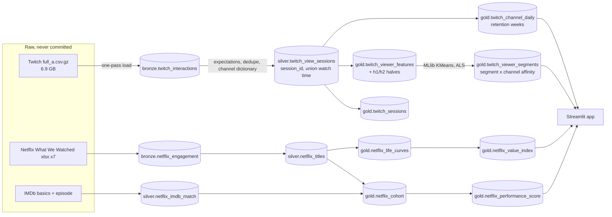

# Streaming content analytics: Spark lakehouse on 475M Twitch viewing logs + Netflix engagement reports

A Databricks-shaped lakehouse (Delta bronze/silver/gold, Lakeflow Declarative Pipeline with expectations, Spark MLlib, MLflow,
Asset Bundle) that answers four questions a content-analytics team asks of a streaming catalogue:

1. **Who are the viewers?** Behavioural segmentation of 15.5M viewers from 474.7M viewing intervals (sessionization, MLlib KMeans, stability checks, ALS channel embeddings).
2. **How does an audience live and die?** Channel audience curves on Twitch (new vs returning, retention cohorts) and title decay curves across Netflix semesters, normalised by exposure.
3. **How will a title perform?** A content performance score from **pre-release features only**, with conformal intervals and a leakage test suite (Netflix titles, LightGBM + SHAP).
4. **What is a title worth over time?** A value index from the life-curve model, validated on a hold-out.

> **Honest status.** Everything ran **locally** (PySpark 4.0.1 + Delta 4.0.0, `local[*]`, 12 cores / 48 GB) on the full data.
> **Nothing has run on Databricks yet**: no workspace existed when this was built. The bundle, the Lakeflow pipeline file and the
> Unity Catalog model registration are written against the documented APIs and **untested on a real workspace**
> ([docs/deploy_databricks.md](docs/deploy_databricks.md) lists the steps and what is unverified, including the Free Edition quota, which is not published and could not be measured).
> **Twitch is a proxy** for streaming consumption (chat presence on a live platform), not subscriber data. The Netflix side has 2,535 titles, not millions of rows.

## Key numbers

All values come from [`reports/results.md`](reports/results.md), which is generated from `reports/results/*.json` by code
(`python reports/make_results.py --check` fails if this table is stale).

<!-- KEY-NUMBERS:BEGIN (generated by reports/make_results.py) -->
| Quantity | Value |
|---|---|
| Twitch interactions processed (bronze rows) | 474,676,930 |
| Silver rows after validation/dedup (rows dropped: 0) | 474,676,930 |
| Viewer sessions (gap rule 3 slots = 30 min) | 349,257,238 |
| Viewers segmented | 15,524,309 |
| Channels | 790,100 |
| Sessionization wall time, full 474M rows (local[*]) | 125 s |
| Chosen k (bootstrap ARI 0.919, silhouette 0.235) | 9 |
| Viewers staying in the same segment first half -> second half | 35.8% |
| eta^2 (H2 log hours): segments / hours in equal-size groups | 0.388 / 0.480 |
| ALS embeddings: bootstrap ARI behaviour-only vs +embedding | 0.662 vs 0.614 |
| Twitch new-channel decay hold-out RMSE (log), large: exp / power / persistence | 1.02 / 1.00 / 1.01 |
| Twitch new-channel decay hold-out RMSE (log), medium: exp / power / persistence | 0.99 / 0.99 / 0.99 |
| Twitch new-channel decay hold-out RMSE (log), small: exp / power / persistence | 0.81 / 0.80 / 0.80 |
| Netflix score, 2026H1 fold: Spearman LightGBM / genre-median / prior-season | 0.69 / 0.53 / 0.60 |
| Netflix score, 2026H1: top-decile precision LightGBM / genre-median | 0.54 / 0.37 |
| Conformal 80% interval empirical coverage, 2026H1 (n=349) | 83.1% |
| IMDb match rate (cohort) | 84.5% |
| Value-index hold-out Spearman (1 semester observed): power / exponential / median-ratio / persistence | 0.87 / 0.82 / 0.85 / 0.85 |
| Value-index hold-out median APE (1 semester observed): power / exponential / median-ratio / persistence | 0.49 / 1.66 / 0.42 / 15.15 |
<!-- KEY-NUMBERS:END -->

## What the results say (including what did not work)

**Volumes.** The Twitch file has 474,676,930 rows, 15,524,309 viewers and 790,100 channels; the source page's "124M interactions / 465k streamers" is stale
(see [data card](docs/data_card.md)). Zero rows failed validation, zero duplicates. Sessionizing all rows (window over 15.5M viewers, 192 partitions) took 125 s on the laptop; the one-pass
load of the unsplittable gzip took 690 s.

**Segmentation.** k = 9 from a pre-declared rule (k in 4-10, bootstrap ARI >= 0.80, then best silhouette). Silhouette is low everywhere (0.22-0.30): behaviour is a
continuum, segments are slices of it. The heavy 14.7% of viewers produce 46.2% of watch time; the other segments split mostly by time-of-day window (dataset clock) and loyalty
(see the profile table in results). 
* Stability is **moderate**: model-vs-model ARI across time halves is 0.77, but only 35.8% of viewers fall in the same segment from the first to the second half of the window.
* Segments **predict second-half volume worse than plain first-half volume cut into 9 equal groups** (eta^2 0.388 vs 0.480). They carry information that volume does not (clock window, loyalty, session length) but do not beat it as a predictor.
* **ALS embeddings did not help**: adding 16 fold-in embedding dimensions lowered bootstrap ARI (0.662 -> 0.614) and eta^2 (0.392 -> 0.313). The channel families are still used for the channel-affinity tables.
* Process note: my first run used single-seed KMeans and picked k = 5 on a lucky bootstrap ARI (0.985) while the seed-only ARI on the same sample was 0.61 (those superseded numbers are kept in `reports/results/earlier_run.json`). I added KMeans restarts (best of 3 per fit), reran everything, and k = 9 came out; the selection rule itself was not changed.

**Life curves, Twitch.** New channels do **not** decay in this window: median daily viewers are flat from day 0 to day 28 in every size tier, and a persistence baseline matches exponential and
power-law fits on held-out days (log-RMSE 0.80 to 1.02 across tiers). Channels are persistent broadcasters, not episodic titles. What does move is the share of returning viewers (mechanically rising as audiences accumulate) and
retention: 27.7% of viewer-channel pairs first seen in week 0 are active again in week 1, 21.5% for week 1 cohorts. (The +6w cell in the retention table covers a single day.)

**Life curves, Netflix.** The median series season's views per exposure day are about 16x lower two semesters after its release semester, and a power law fits far better than an exponential (within-title MSE on log rate 0.20-0.25 vs 0.80-0.89 in the table). Late-age points are survivors (titles under the 50k-view floor disappear), so levels at old ages are biased upward.


**Performance score.** On the latest hold-out (2026H1, 349 titles) LightGBM reaches Spearman 0.69 vs 0.53 for a genre-median baseline and 0.60 for the prior-season baseline; top-decile precision 0.54 vs 0.37.
It is **not uniformly better**: on the 2025H1 fold the genre median (0.575) and prior season (0.635) have a higher Spearman than LightGBM (0.547), and on titles that have a prior season the prior-season baseline is as good or better on Spearman in all three folds.
The 80% conformal interval covers 74.5%, 86.0% and 83.1% across the three folds, and is wide (about 15x to 25x between lower and upper views). The strongest SHAP features are a non-English-title flag, genre, kind, IMDb runtime and exposure days.


**Value index.** Predicting views over the remaining semesters up to semester 4 for 2024 cohorts, a power-law life curve is the best parametric choice (Spearman 0.87 with one semester observed, 0.92 with two) and a non-parametric median-ratio method has a lower median error with one semester (0.42 vs 0.49).
Persistence of the last rate is a poor baseline (median absolute percentage error 15.1, i.e. about 1,500%, with one semester observed, because the first, partial semester is a launch burst). 1,344 of 2,635 titles are fully observed over four semesters; the rest are partly forecast.

## Architecture



Implemented with Delta tables in Unity Catalog naming (`<catalog>.<bronze|silver|gold>.<table>`); locally the same code writes Delta to `data/warehouse`.
[`pipelines/twitch_pipeline.py`](pipelines/twitch_pipeline.py) is the Lakeflow Declarative Pipeline version of bronze -> silver (expectations: valid duration, slot range, non-null keys, no corrupt rows, session ids >= 1)
and calls the same functions the tests exercise. The Netflix models are logged with MLflow (file store locally; Unity Catalog registry when running on Databricks).

## Rigor

* **Leakage tests** ([tests/test_netflix_leakage.py](tests/test_netflix_leakage.py)): corrupting every views/hours value from a cut-off semester onward must not move any feature of titles released in that semester (and must move the target, so the test can fail);
  prior-season features may only use semesters that ended before the release date; exposure normalisation for partial semesters; no target-derived column in the feature list. Temporal folds only; no ratings/votes from IMDb.
* **Sessionization tests** cover the gap boundary, parallel streams (running max, union watch time) and per-viewer isolation; feature tests check entropy, repeat share and clock shares on hand-computed viewers.
* **Spark tuning** (`reports/results.md` section 2, 10% viewer sample, local): partition count matters a little (8 partitions 13.1 s vs 192 partitions 8.3 s for the viewer window), broadcasting the 790k-row channel dimension helps modestly (2.2 s -> 1.7 s),
  a two-phase "salted" distinct count was **slower** than the plain `countDistinct` (4.4 s -> 7.0 s; the skew is on channels with up to 707,639 intervals but a single machine does not suffer from it), and liquid clustering / Z-order made a point lookup of 2,000 viewers 0.35 s -> 0.26-0.27 s (confounded by compaction from 48 files to 1).
  These are single-machine numbers and say little about serverless.
* **Reproducibility**: raw files are fetched by `ingest/download.py` with SHA-256 checksums in `ingest/checksums.json`; every number in this README is in `reports/results.md`, generated by `reports/make_results.py`.

## Limits

* Twitch is a proxy; Twitch timings are from one laptop; the 30-minute session gap was not tested for sensitivity.
* Netflix has semester granularity and rounds views to 100k; only titles with a release date from 2023 on enter the cohort; the performance target is the *release semester* (not the first full semester, which is censored and missing for the newest titles); 15.5% of cohort titles have no IMDb match.
* Life-curve fits ignore survivorship; the value index for young titles is a forecast. No business impact is estimated: there are no costs, revenues, subscribers or A/B tests in the data.
* Details and leakage traps: [docs/methodology.md](docs/methodology.md), [docs/data_card.md](docs/data_card.md), [docs/model_card.md](docs/model_card.md).

## Run it

```bash
uv sync                                   # Python 3.12; needs a JDK 17 on the PATH for PySpark (macOS: brew install openjdk@17 libomp)
python ingest/download.py all             # ~7.4 GB; Twitch full file is 6.9 GB; use `twitch100k` first to try the pipeline
python jobs/run.py twitch-bronze && python jobs/run.py twitch-silver && python jobs/run.py twitch-features
python jobs/run.py twitch-segments && python jobs/run.py twitch-lifecurves && python jobs/run.py twitch-tuning
python jobs/run.py netflix
python jobs/export_app_data.py && streamlit run app/streamlit_app.py
python reports/make_results.py && python reports/make_figures.py
uv run pytest                             # synthetic fixtures only, no raw data
```
Deploy to Databricks: [docs/deploy_databricks.md](docs/deploy_databricks.md). Streamlit app: a title page (score, interval, life curve, comparables, value index), a Twitch channel audience page and a segments page.

## Data and licences

Twitch: Rappaz, McAuley, Aberer, RecSys 2021 (cite the paper; the dataset page states no licence). Netflix "What We Watched" reports: public, not redistributed. IMDb non-commercial datasets: personal and non-commercial use, not redistributed.
No raw or per-title derived data is committed.
