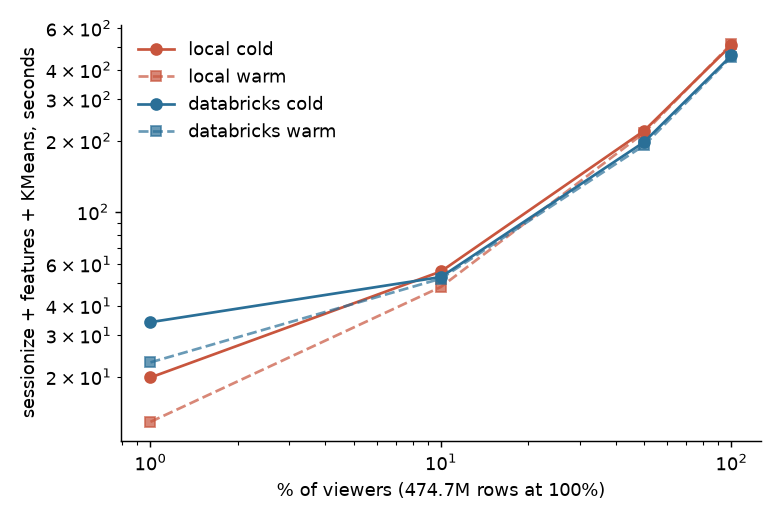

# Local (one Mac) vs Databricks Free Edition serverless

**What this is.** Measurements of *this* Free Edition environment (serverless, no cluster choice, quota-limited) against *one* workstation (Apple M-series, 12 CPU threads, 48 GB RAM, Spark `local[*]`, 24 GB driver heap). It says nothing about paid Databricks clusters. Every number below comes from committed result files (`reports/results/benchmark_*.json`, `reports/results/databricks/*.json`); this file is generated by `reports/make_benchmark_report.py`.

Both sides run identical code (`streaming_content.benchmark`): bronze Delta table filtered to a viewer-hash sample -> clean + dedupe + sessionize (window by viewer, Delta write) -> 15 viewer features (Delta write) -> MLlib StandardScaler + KMeans (k=7, 20 iterations). No explicit caching on either side. Three repeats in one process: repeat 1 is *cold* (new Spark session / serverless task, first read), repeats 2-3 are *warm*; the table shows medians.

## Throughput vs volume

| Volume (viewer sample) | Interval rows | Viewers | Where | Sessionize s (cold) | Features s (cold) | KMeans s (cold) | Total s (cold) | Total s (warm, median) |
|---|---|---|---|---|---|---|---|---|
| 1% | 4,764,554 | 155,542 | local | 11 | 5 | 3 | 20 | 13 |
| 1% | 4,764,554 | 155,542 | databricks | 18 | 7 | 9 | 34 | 23 |
| 10% | 47,429,616 | 1,552,616 | local | 19 | 31 | 6 | 56 | 48 |
| 10% | 47,429,616 | 1,552,616 | databricks | 18 | 23 | 12 | 53 | 52 |
| 50% | 237,382,905 | 7,761,233 | local | 58 | 149 | 13 | 220 | 216 |
| 50% | 237,382,905 | 7,761,233 | databricks | 50 | 94 | 53 | 197 | 191 |
| 100% | 474,676,930 | 15,524,309 | local | 107 | 379 | 22 | 508 | 515 |
| 100% | 474,676,930 | 15,524,309 | databricks | 92 | 236 | 132 | 459 | 454 |

**Crossover (warm totals)**: Databricks serverless is faster from 50% of the data upward.

At 100% (all 474,676,930 rows) the warm total is 454 s on Databricks vs 515 s on the Mac; the feature aggregation is faster on serverless (198 s vs 384 s) while the MLlib KMeans fit is slower (166 s vs 22 s). At 1% the Mac is faster (13 s vs 23 s).

## Where the Mac stops coping (100% of the data, smaller JVM heap, one run each)

| Driver heap | Total | Detail |
|---|---|---|
| 8g | 595 s | sessionize 178 s, features 394 s, KMeans 23 s |
| 4g | FAILED | SparkOutOfMemoryError: [UNABLE_TO_ACQUIRE_MEMORY] Unable to acquire 262144 bytes of memory, got 0. SQLSTATE: 53200 |

## Latency

**Dashboard queries on gold tables** (SQL warehouse, 2X-Small serverless starter, vs local Spark SQL on the same tables; seconds, 5 repetitions after one cold run; warehouse cold start 7.8 s):

| Query | Warehouse p50 | Warehouse p95 | Local Spark p50 | Local Spark p95 |
|---|---|---|---|---|
| segments | 1.22 | 1.63 | 0.38 | 0.42 |
| netflix_curve | 1.27 | 1.45 | 0.15 | 0.17 |
| score | 1.16 | 1.47 | 0.13 | 0.13 |
| value | 1.13 | 1.15 | 0.10 | 0.10 |
| retention | 1.05 | 1.14 | 0.18 | 0.19 |
| stream | 1.14 | 1.36 | 0.37 | 0.39 |

**Structured Streaming replay** (micro-batch duration p50 / p95 / p99 seconds, one file per batch; a replay, not live ingestion):

| Query | Databricks batch s | Databricks rows/s | Mac batch s | Mac rows/s |
|---|---|---|---|---|
| per_channel | 13.8 / 15.7 / 16.1 | 9,970 | 1.1 / 1.6 / 1.9 | 121,676 |
| platform | 6.3 / 8.7 / 11.3 | 20,667 | 0.9 / 1.3 / 1.3 | 144,949 |

**Model Serving** (per-request, 100 sequential requests from a Mac in Europe, 1 row each): p50 148 ms, p95 217 ms, p99 271 ms; first request 0.74 s. Includes network round trip; no local FastAPI comparison was run.

**Genie** answers: 16.9, 17.0, 17.0, 17.2, 19.6 s (5 questions, median 17.0 s).

**Startup** (time from process start of `jobs/run.py` to the first Spark action returning, inside the task; 4 Databricks tasks, 4 local processes): Databricks serverless task median 1.0 s (min 0.9, max 1.1); local `local[*]` session median 4.3 s (min 4.3, max 4.8). This excludes the serverless environment build/queue time before the task starts (the Jobs API reports `setup_duration`, 1-9 s in these runs, plus the time a run waits in the queue when another run of the same job is active).

## Operational differences (described, not timed)
* **Runs with the laptop closed**: Databricks jobs and the Lakeflow pipeline run on serverless compute without the Mac; the local run needs the machine awake for the whole 25+ minute segmentation.
* **Scheduling and orchestration**: the Asset Bundle defines multi-task DAGs (dev target deployed; `prod` target not created); locally every stage is a manual command.
* **Data quality gates**: Lakeflow expectations (warn/drop/fail) with pass/fail counts in the event log; locally the equivalent checks are code in `clean_views`.
* **Lineage, comments, tags, constraints, time travel**: provided by Unity Catalog and Delta on Databricks (see results section 10); local Delta has time travel but no lineage or governance.
* **Model registry and serving**: UC registry with `champion` / `challenger` aliases and a Model Serving endpoint; local MLflow is a file store.

## Limitations
* One workstation vs one Free Edition workspace, one day, one region; times vary run to run and with Databricks' shared capacity. Medians of three runs hide that spread (all runs are in the JSON files).
* Serverless gives no control over cluster size; local `local[*]` gives all 12 cores. Free Edition quotas were not hit during these runs, but the quota size is unpublished, so repeating the benchmark may not be possible every day.
* The Mac numbers use a 24 GB heap on a 48 GB machine; the constrained-heap rows show where it degrades, they are not a claim about other laptops.
* The ingest step is not in the volume sweep: Databricks reads 24 gzip parts in parallel, the original 6.9 GB gzip is a single task (local: 690 s). A like-for-like local run of the 24 parts was not performed.
* Spark confs for shuffle partitions, AQE and broadcast thresholds cannot be set on serverless, so those tuning experiments are local only (`reports/results/tuning.json`).
